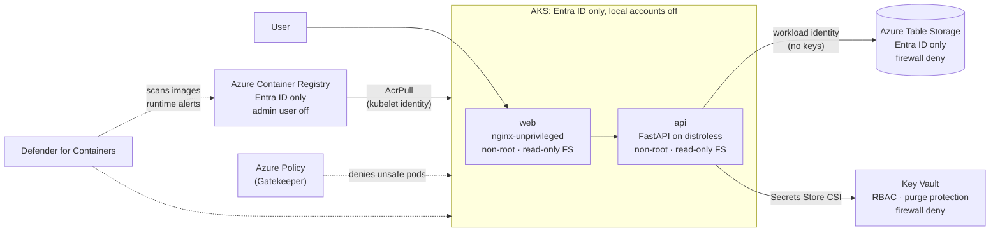
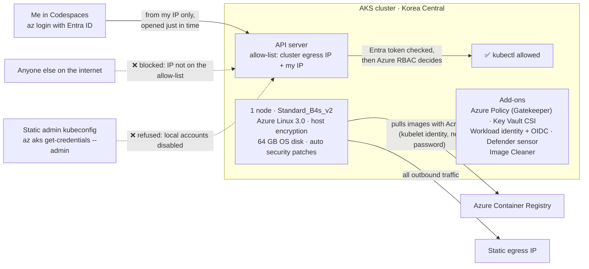
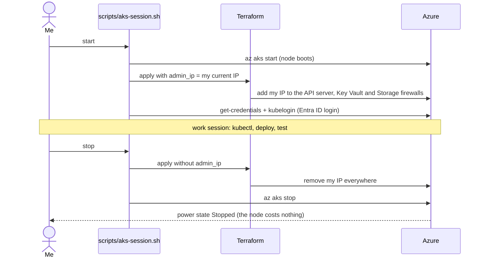
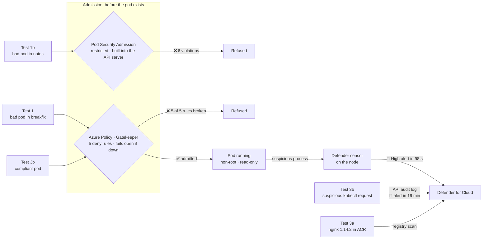
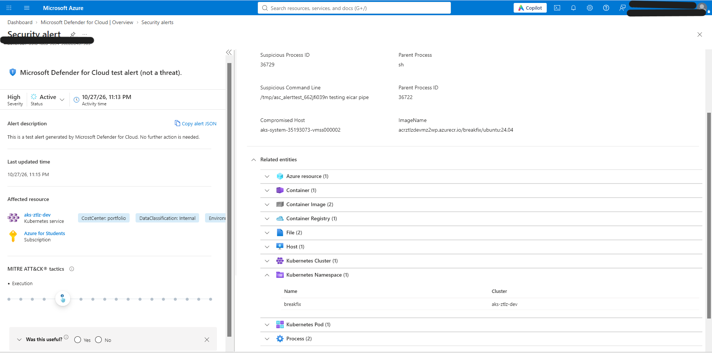

# Zero-Trust Container Landing Zone on Azure

**Hardened Docker images, a locked-down AKS cluster, and Azure Policy guardrails that refuse anything unsafe, before it ever runs.**

> 🚧 **Status: in progress.** This README tells the plan as a story; each chapter is ticked off as it is built, with evidence.
> Part 2 of my DevSecOps portfolio. Part 1: [multicloud-secure-iac](https://github.com/Subash-1507/multicloud-secure-iac), secure infrastructure as code with keyless, approval-gated deployments.

---

## The story

In my first project I secured the *infrastructure*: Terraform, scanners on every pull request, and a pipeline that deploys to Azure without a single stored password. But infrastructure is only the floor. What actually runs on it is **containers**, and that is where most real-world incidents start:

- an image pulled from a public registry that nobody has checked,
- a container running as **root**, one escape away from the host,
- a password baked into an image layer,
- a resource created by hand at 2 a.m. with no owner and no tags.

So I asked a simple question: **what if the platform itself said "no"?**

Not a checklist someone may forget, not a wiki page. A landing zone where:

1. **Images are hardened by design**: built in stages, on a minimal base, as a non-root user.
2. **Only my private registry is trusted**: a container from anywhere else is rejected at the door.
3. **Azure Policy blocks unsafe deployments** automatically: root containers, privilege escalation, untagged resources, an open Key Vault.
4. **No credentials exist anywhere**: the app reaches its secrets and data through managed identities.
5. **Defender for Cloud watches continuously**, scans images for vulnerabilities and maps everything to a compliance framework.

And then I **try to break my own rules** (deploy a root container from Docker Hub, create an untagged resource, push a vulnerable image) and capture the platform stopping me. A control you have not tested is only a hope.

---

## What I am building



**Three tiers:** a web front end, an API, and a data store, so the security controls are tested on something that behaves like a real application, while staying small enough that the focus stays on security rather than app code.

---

## The plan, chapter by chapter

| | Chapter | What happens | Evidence I will capture |
|---|---|---|---|
| ✅ | **0. Foundations** | Repo, Codespaces dev container, CI security gates (Hadolint, Trivy, SBOM, Checkov, Gitleaks, Terraform validate) | Green pipeline |
| ✅ | **1. Hardened images** | Build a deliberately naive image first, then a hardened multi-stage, distroless, non-root version | **Before/after: image size and CVE count** |
| ✅ | **2. Guardrails first** | Custom and built-in Azure Policies, grouped into one initiative, assigned **before** any resource exists | Compliance blade, policy JSON |
| ✅ | **3. Landing zone** | VNet, Container Registry, Key Vault and Storage, each locked down | Resource configuration |
| ✅ | **4. The cluster** | AKS with the Azure Policy add-on, workload identity, Entra ID-only access, Defender for Containers | Cluster security settings |
| ✅ | **5. Deploy the app** | Kubernetes manifests with strict security contexts, default-deny network policy, secrets from Key Vault | Running app, no secrets in the cluster |
| ✅ | **6. Break-fix tests** | Three deliberate violations (below) | **Screenshots of each block or alert** |
| ⬜ | **7. Compliance and teardown** | Map controls to NIST SP 800-190 and CIS, then delete everything | Mapping table, cost report |

---

## Chapter 4 in pictures: the cluster

**Who can reach the cluster, and how.** Three locks sit in front of the API server: my IP must be on the allow-list (opened only while I work), my Entra ID login must be valid, and Azure RBAC must grant the action. There is no static admin password to steal, because local accounts are disabled.



**The session routine.** The cluster is stopped when I am not using it, and my IP is added only for the length of a work session. Both are one command, and Terraform remains the single source of truth for the firewall rules.



**Problems I solved along the way**
- **No usable VM sizes in Southeast Asia:** my subscription was offered only Arm64 sizes there, so I moved the landing zone to Korea Central ([ADR 0001](docs/decisions/0001-region-koreacentral.md)).
- **The first node ran out of room:** a 2 vCPU node with a 32 GB disk hit `DiskPressure`, with 86% of its CPU already requested by system add-ons. I rebuilt it on 4 vCPU with a 64 GB disk, and requested CPU dropped to 52%.
- **The evidence must be honest:** a wrong query field showed the node OS upgrade channel as `null`. I checked the real value (`SecurityPatch`) and corrected the evidence file instead of leaving it.

Evidence: [docs/evidence/05-aks-cluster.txt](docs/evidence/05-aks-cluster.txt)

---

## Security controls

| Risk | Control | Enforced by |
|---|---|---|
| Container runs as root | Images built as a non-root user; pods must run as non-root | Dockerfile + **Azure Policy (Deny)** |
| Privilege escalation, privileged containers | `allowPrivilegeEscalation: false`, all Linux capabilities dropped | **Azure Policy (Deny)** |
| Tampered or writable container filesystem | Read-only root filesystem | **Azure Policy (Deny)** |
| Untrusted images | Only images from my Azure Container Registry may run | **Azure Policy (Deny)** |
| Vulnerable images | Image scanning with Trivy in CI and Defender in Azure | CI gate + **Defender for Containers** |
| Hardcoded credentials | Managed identities and workload identity; secrets only in Key Vault | Design + Gitleaks in CI |
| Exposed Key Vault | Firewall default deny, VNet access only | **Azure Policy (Deny)** |
| Ungoverned resources | Environment, CostCenter and DataClassification tags required | **Custom Azure Policy (Deny)** |
| Unauthorized cluster access | Entra ID authentication only, Kubernetes local accounts disabled | AKS configuration |

---

## Break-fix tests: trying to break my own rules

| # | What I will try | What should happen |
|---|---|---|
| 1 | Deploy `nginx` from **Docker Hub**, running as **root** with privilege escalation allowed | The cluster **rejects** it, listing every policy it breaks |
| 2 | Create Azure resources **without governance tags** and a Key Vault **with no firewall** | Azure Resource Manager **refuses** the request (`RequestDisallowedByPolicy`) |
| 3 | Push a deliberately **outdated, vulnerable image** and simulate suspicious activity in the cluster | Defender **reports the CVEs** and raises a **security alert** |

### Chapter 6 results: what actually happened

| # | What I tried | What happened |
|---|---|---|
| 1 | `nginx` from **Docker Hub**, as **root**, **privileged**, with privilege escalation and a writable filesystem | ❌ **Denied** by Azure Policy (Gatekeeper), naming **all 5** broken rules. Nothing was created |
| 1b | The same pod in the app namespace | ❌ **Denied** even earlier, by Kubernetes **Pod Security Admission** (`restricted`), with 6 violations |
| 2 | An untagged storage account, and a Key Vault with no firewall | ❌ **Denied** by Azure Resource Manager (`RequestDisallowedByPolicy`), see [evidence 03](docs/evidence/03-policy-break-fix.txt) |
| 3a | `nginx:1.14.2` (2019, Debian 9, end-of-life) imported into my registry | **Trivy:** 216 CVEs, 77 of them fixable HIGH/CRITICAL, so the CI gate would block it. **Defender:** 6 fix recommendations on all 6 architecture images, worst **CVSS 9.8**, about 40 minutes after import |
| 3b | A suspicious process inside a **fully compliant** pod | ✅ Admitted, then 🚨 Defender raised a **High** alert (MITRE ATT&CK: Execution) **98 seconds** later, naming the image, node and command line. A second test through the API audit log raised a control-plane alert after **19 minutes** |



**What the tests taught me**
- **Gatekeeper fails open.** Its webhook runs with `failurePolicy: Ignore`, so if the policy engine is down, pods are admitted unchecked. Pod Security Admission lives inside the API server and cannot be "down", which is why the app namespace has both layers.
- **Prevention alone is not enough.** The pod in test 3b broke no rule, yet ran a suspicious binary. Admission control judges what a pod *is*; only runtime detection sees what it *does*. That is the "assume breach" half of zero trust.
- **Detection has two speeds.** The node sensor raised its alert in 98 seconds; the same test through the API audit log took 19 minutes. Fast response needs the sensor, not log analysis alone.
- **Two scanners, two counts.** Trivy lists every known CVE, including ones Debian 9 will never fix; Defender groups findings into the package updates that fix them. One gates the pipeline, the other watches the registry continuously.



Evidence: [docs/evidence/07-break-fix-admission-and-runtime.txt](docs/evidence/07-break-fix-admission-and-runtime.txt) and [the image scan screenshot](docs/evidence/07-defender-image-scan.png) · How to rerun: [tests/break-fix](tests/break-fix/)

---

## Honest trade-offs

This is a personal project on student credits, so I chose a **budget build** and I am recording what that costs in security, the same way a real team records accepted risk:

| Trade-off | Why | Production alternative |
|---|---|---|
| Container Registry on the **Basic** tier, reachable over the internet (Entra ID login required, admin user off) | Private endpoints and network rules need the Premium tier | Premium tier with a private endpoint; the matching policies switch from Audit to Deny |
| Key Vault and Storage use **firewalls and VNet service endpoints**, not private endpoints | Private endpoints cost extra per endpoint | Private endpoints and private DNS zones |
| AKS API server is public, restricted to my IP and Entra ID login | A private cluster needs a jump host | Private cluster |
| Gatekeeper's webhook **fails open** (`failurePolicy: Ignore`, set by AKS) | AKS keeps the cluster manageable even if the policy engine fails | Pod Security Admission `restricted` on every app namespace (done here), plus an alert on Gatekeeper's health |

**Cost plan:** about $8–12 of credits if built within a week, then **everything is deleted**. Defender for Containers runs on its free trial.

---

## Repository layout (planned)

```
app/            web and api source, with hardened Dockerfiles
policies/       custom Azure Policy definitions and the initiative (policy as code)
infra/          Terraform: governance, network, registry, Key Vault, AKS, Defender
k8s/            Kubernetes manifests: namespaces, deployments, network policies, identities
tests/          the three break-fix scenarios
docs/           architecture, compliance mapping, evidence screenshots
.github/        CI security gates and the deployment workflow
```

---

## Author

**Subash Chandra Bose**: DevOps, Cloud & Security Engineer · Microsoft Certified (SC-500, AZ-104, SC-200)
[Portfolio](https://subash-1507.github.io) · [LinkedIn](https://www.linkedin.com/in/subash-chandra-bose-014bb21b5) · [GitHub](https://github.com/Subash-1507)
